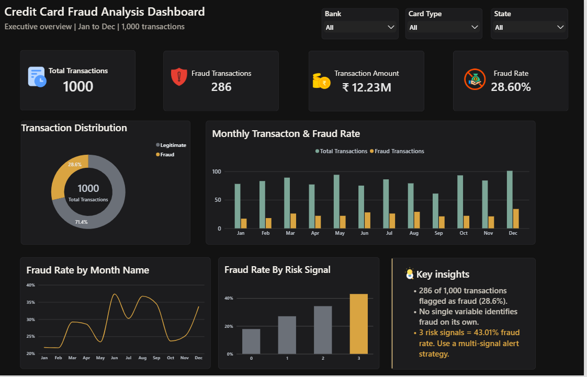

# Credit-Card-Fraud-Detection-Analysis
Analyzed credit card transactions using Python and Power BI to identify fraud patterns, evaluate risk signals, and recommend real-time fraud alert rules.

## Project Overview

This project focuses on analyzing credit card transactions to identify
fraud patterns, understand risk signals, and recommend risk-based
alert rules using Python and Power BI.

The project combines exploratory data analysis with interactive
dashboard development to support data-driven fraud monitoring.

## Business Problem

Financial institutions need to identify suspicious transaction
patterns and develop effective alert mechanisms to detect potential
fraudulent activities.

The objective is to analyze transaction characteristics, identify
patterns associated with fraud, and recommend a multi-signal
alert strategy.

## Key Questions

- What transaction patterns are associated with fraudulent activity?
- Which fraud types have the highest fraud counts and rates?
- How do fraud rates vary across card types, banks, and states?
- Does combining multiple risk signals improve fraud identification?
- What alert thresholds can be recommended for suspicious transactions?

## Tech Stack

- Python
- Pandas
- Matplotlib
- Seaborn
- Jupyter Notebook
- Microsoft Power BI
- DAX

## Dataset

The dataset contains 1,000 credit card transaction records and
includes transaction amounts, fraud labels, fraud types, card types,
banks, states, fraud scores, and risk-related attributes.

Data cleaning and exploratory analysis were performed using Python.

## Project Workflow

1. Data loading and inspection
2. Data quality checks
3. Data cleaning and feature engineering
4. Exploratory data analysis
5. Fraud pattern analysis
6. Risk signal analysis
7. Power BI dashboard development
8. Risk-based alert rule recommendations

## Key Findings

- Total transactions analyzed: 1,000
- Transactions labelled as fraudulent: 286
- Observed fraud rate: 28.60%
- Card Not Present had the highest fraud count among fraud types,
  with 72 fraudulent transactions.
- Identity Theft had the highest observed fraud rate among fraud
  types, at 32.82%.
- Transactions with 3 risk signals had an observed fraud rate
  of 43.01%.

These findings describe the supplied dataset and should not be
interpreted as representative of real-world fraud rates.

## Risk-Based Alert Recommendations

| Risk Signals | Alert Level | Recommended Action |
|---|---|---|
| 0–1 | Low | Normal processing |
| 2 | Medium | Additional verification |
| 3+ | High | Priority alert and manual review |

The proposed thresholds are exploratory recommendations based on
observed patterns in the dataset. They have not been validated
for production deployment.

## Power BI Dashboard

The dashboard contains three pages:

### Page 1: Executive Overview
- Total transactions
- Fraud transactions
- Overall fraud rate
- Total transaction amount
- Monthly transaction and fraud trends

### Page 2: Fraud Pattern Analysis
- Fraud type analysis
- Highest fraud type
- State-wise fraud analysis
- Card type fraud rate comparisons
- Bank-wise fraud analysis

### Page 3: Risk & Alert Analysis
- Average risk signals
- Transactions with 3+ risk signals
- Highest observed fraud rate by risk signal count
- Recommended alert triggers
- Risk-based alert rule recommendations

